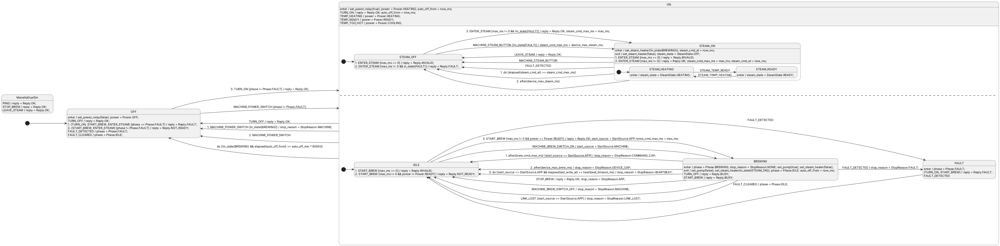

# Manetta, dual boiler: orthogonal regions (EXPERIMENTAL)

The single-boiler example (`../manetta-example`) has one heater, so brewing and steaming exclude each other and one machine plus variables is enough.
A **dual-boiler** machine is different: the steam boiler really runs *in parallel* with brewing (steam milk while a shot is pulled).
It has its own sensor, its own heating/ready cycle and its own caps.

This example uses **orthogonal regions**, implemented on branch `north-star` (roadmap P5 in [`/NORTH_STAR.md`](../../../NORTH_STAR.md)).
`ManettaDualSm.plantuml` is the only source. Rust and TypeScript are generated from it with no glue, like the single-boiler example.



## The model

```
state ON {
    [*] --> STEAM_OFF                 ' STEAM BOILER region
    state STEAM_OFF
    state STEAM_ON { STEAM_HEATING, STEAM_READY }
    --                                ' the region separator
    [*] --> IDLE                      ' BREW region
    state IDLE
    state BREWING
    state FAULT
}
```

- **ON** is the orthogonal parent. While it is active, *both* regions are active: one state from each.
  The generated machine keeps one state id per region: `on_region_1_state_id` (steam boiler) and `on_region_2_state_id` (brew).
  `state_id` stays `ON`.
- **Events go to every region in order** (steam boiler first, then brew). ON and the root get an event only if no region consumed it.
  So `TEMP_READY` (brew boiler sensor) reaches ON's handler, while `FAULT_DETECTED` is handled in *both* regions at once:
  the steam boiler switches off **and** the brew region goes to FAULT, from one dispatch.
- **`do` reaches every region and then ON.** Each region runs its own timers: steam command cap and device cap, brew caps and heartbeat. ON runs auto-off.
- **Rules between the regions** are `in_state(X)` guards and actions. `in_state(X)` is true while X or a state inside it is active, in any region.
  - Brew priority (shared power budget):
    - `STEAM_ON : enter / set_steam_heater(!in_state(BREWING))`;
    - `BREWING : enter / ... set_steam_heater(false)` and `exit / ... set_steam_heater(in_state(STEAM_ON))`.
  - A fault refuses steam: `STEAM_OFF --> STEAM_ON : 3. ENTER_STEAM [max_ms != 0 && !in_state(FAULT)]`.
  - Auto-off never during a brew: `ON --> OFF : do [!in_state(BREWING) && elapsed(auto_off_from) >= auto_off_min * 60000]`.
  - Power switch during a brew records why it stopped: `ON --> OFF : 1. MACHINE_POWER_SWITCH [in_state(BREWING)] / stop_reason = StopReason.MACHINE;`.
- **Leaving ON exits both regions** (brew region first, reverse order), then ON. Entering ON enters each region's initial state.

Compared with the single-boiler diagram, the steam rules no longer interfere with brewing: there is no "STEAM blocks the temperature events" behaviour, and no BUSY for ENTER_STEAM during a brew.
Each concern keeps its own states, and every cross rule is a visible `in_state()`.

## Scenarios

`scenarios.txt` uses the same runner commands as the single-boiler example. The state column is `OFF` or `ON[<steam boiler>|<brew>]`.

| # | What it shows |
|---|---|
| 1 | Steam and brew at the same time: steam READY while BREWING; the brew stops on its command cap while steam stays on |
| 2 | Brew priority: ENTER_STEAM during a brew enters STEAM_HEATING with the heater off (`steam_on=0`); STOP_BREW turns it on |
| 3 | ENTER_STEAM is OK while the brew boiler is still heating; START_BREW is still NOT_READY until `TEMP_READY` |
| 4 | One FAULT_DETECTED stops the brew **and** the steam boiler; steam and brew are refused (FAULT) until FAULT_CLEARED |
| 5, 6 | A fault survives TURN_OFF as the OFF fault flag (same as the single boiler); fault while off |
| 7 | TURN_OFF during a brew is BUSY; afterwards it turns both regions off |
| 8 | Machine power switch during a brew with steam on: everything off, `stop=MACHINE` |
| 9 | Steam caps: command cap, a repeat ENTER_STEAM restarts it, device cap (counts from entering STEAM_ON); `max_ms 0` is INVALID |
| 10 | The machine's steam button toggles the steam boiler |
| 11, 12 | Link loss and heartbeat stop an app brew, never the steam boiler; a machine brew ignores the heartbeat |
| 13 | Auto-off: steam doesn't hold it off, a brew does. The steam cap fires at 120 s, auto-off 60 s after the brew ends |
| 14 | Both regions' timers in the same `do`: the brew command cap at 2 s, the steam command cap at 4 s |

## Results

- **Rust == TypeScript:** `trace-rust.txt` and `trace-ts.txt` are identical (14 scenarios).
- **Sleeping host == polling host:** `next_deadline_ms()` covers the timers of every active region, because each region state is checked against its own region variable.
  The trace is identical in both modes: 1,695 `do` dispatches when polling every 100 ms, 21 when sleeping until the next deadline.
- **no_std:** `rust-nostd/` builds for `riscv32imc-unknown-none-elf` with `opt-level = "s"`.
  The whole crate object is **2,640 B `.text`**, 0 data, 0 bss; the only external symbol is `memset`.
  The single-boiler crate is 2,372 B on the same toolchain, so two regions cost +268 B. The demo also dispatches ENTER_STEAM, which the single-boiler one doesn't.
- **RAM:** `size_of::<ManettaDualSm<_>>()` is 68 B, against 64 B for the single boiler (two region state ids, two internal flags).
- **Clippy:** the generated Rust is clippy-clean.
- **Diagram:** 174 lines, against 191 for the single boiler. Generated code: `manetta_dual_sm.rs` 1,757 lines, `ManettaDualSm.ts` 1,896 lines.
- **Simulator:** `ManettaDualSm.sim.html` draws the regions inside ON (Mermaid `--`) and highlights the active state of each region.
  It enables the event buttons of every active state.
  Known gap: it marks an edge of ON as available if any region leaves it to ON. While BREWING (which answers TURN_OFF with BUSY),
  ON's `TURN_OFF` edge still shows as available because the steam region doesn't handle TURN_OFF. The generated code does it right: a region that consumes an event hides it from ON.

## Region rules (what StateSmith accepts)

Allowed:
- regions in any state except the root;
- nested regions (an orthogonal state inside a region);
- history inside a region;
- transitions from a region state to anywhere outside the orthogonal parent (that exits every region);
- transitions from outside into one region's state (the other regions enter their initial states).

Rejected, with a clear error:
- transitions between regions of the same parent, or from the parent into one of its regions;
- targeting a region itself;
- behaviours on a region;
- history that reaches into a region;
- algorithm Balanced1 (Balanced2, the default, is required).

Coordinate regions with `in_state()`, variables, or events instead.

**PlantUML drawing limits (version 1.2024.7)** affect only the picture, not StateSmith:
- PlantUML can't draw a transition written *outside* `ON { }` that starts or ends in the second (or later) region,
  so the brew region's transitions are written inside the `ON { }` block.
- It can't draw a transition from the second region to a state outside ON either. `BREWING --> OFF : MACHINE_POWER_SWITCH` therefore became a guarded ON transition.
  It behaves the same, because the guard is checked before anything exits.

## Regenerate and run

```bash
cd src/StateSmithTest
dotnet test --filter "FullyQualifiedName~ManettaDualBoilerGenTests"   # regenerates Rust + TS + simulator, runs both, compares traces, poll vs sleep
```

```bash
cd src/test-misc/manetta-dual-boiler/rust && cargo run > ../trace-rust.txt
```

```bash
cd src/test-misc/manetta-dual-boiler/ts && tsc -p . && node dist/runner.js > ../trace-ts.txt
```

```bash
cd src/test-misc/manetta-dual-boiler/rust && cargo run -- --sleep | diff - ../trace-rust.txt && echo "sleeping host == polling host"
```

```bash
cd src/test-misc/manetta-dual-boiler/rust-nostd && cargo build --release --target riscv32imc-unknown-none-elf
```

```bash
cd src/test-misc/manetta-dual-boiler && java -jar plantuml.jar -tpng ManettaDualSm.plantuml   # needs Graphviz
```

Files:
- `ManettaDualSm.plantuml`: the source diagram. `ManettaDualSm.svg` / `.png` are the picture; `ManettaDualSm.sim.html` is the simulator.
- `scenarios.txt`: the scenarios both runners play. `trace-rust.txt` and `trace-ts.txt` are their outputs.
- `rust/`:
  - `src/manetta_dual_sm.rs`: generated;
  - `src/main.rs`: the scenario runner.
- `rust-nostd/`: a `#![no_std]` staticlib that uses the generated module via `#[path]`.
- `ts/`:
  - `ManettaDualSm.ts`: generated;
  - `runner.ts`: the scenario runner.
- [`../../StateSmithTest/Output/Rust/ManettaDualBoilerGenTests.cs`](../../StateSmithTest/Output/Rust/ManettaDualBoilerGenTests.cs): the generator and the trace comparison test.
