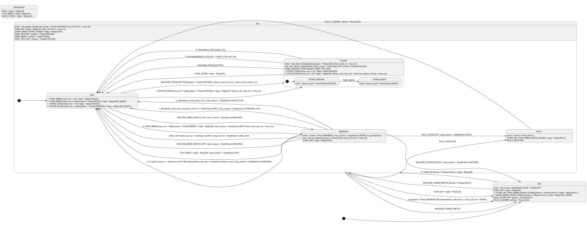

# Manetta example: one diagram, Rust + TypeScript

A cut-down Manetta device state machine, drawn once in PlantUML and generated twice:
- **Rust** (`rust/src/manetta_sm.rs`), using the experimental Rust target from the `rust-spike` branch (see `/RUST_SPIKE.md`);
- **TypeScript** (`ts/ManettaSm.ts`), using StateSmith's existing TypeScript target.

Both runners play the same `scenarios.txt` and print the same trace. **The two traces are byte-identical** (140 lines, 12 scenarios).
The Rust module also builds as `#![no_std]` for `riscv32imc-unknown-none-elf`.

| | Result |
|---|---|
| Same diagram text for both languages | yes. Only the glue differs: variable declarations rendered from one table, plus about 10 helper expansions |
| Rust trace == TypeScript trace | **identical** (`diff trace-rust.txt trace-ts.txt` is empty; checked by `ManettaExampleGenTests.RustAndTypeScriptTracesMatch`) |
| Rust warnings | 0 rustc and 0 clippy warnings for the runner crate and the no_std crate |
| TypeScript | `tsc` 6.0 with `strict`, target ES2020: no errors |
| no_std, `riscv32imc-unknown-none-elf`, `opt-level = "s"` | builds. Whole crate object: **2,080 B `.text`**, 0 data, 0 bss. The only external symbol is `memset` (from `compiler_builtins`) |

## The diagram

Source: [`ManettaSm.plantuml`](ManettaSm.plantuml). Rendered with PlantUML 1.2024.7 + Graphviz:



(`ManettaSm.png` is the same picture. `ManettaSm.sim.html` is StateSmith's interactive simulator. It loads mermaid and svg-pan-zoom from
`cdn.jsdelivr.net`, so it works in a normal browser. I couldn't render it in the sandbox it was built in, because that host is blocked there.)

### Structure

```
MANETTA                      PING / STOP_BREW / LEAVE_STEAM answer OK; FAULT_DETECTED -> FAULT
├── OFF                      relay off. START_BREW, ENTER_STEAM -> NOT_READY
├── ON                       relay on. TEMP_* events update `power`; START_BREW, ENTER_STEAM default to BUSY
│   ├── IDLE                 starts brews and steam; auto-off
│   ├── BREWING              pump on; command cap, device cap, heartbeat, STOP_BREW, machine switch, link loss, fault
│   └── STEAM                steam heater on, power reports ON; caps, LEAVE_STEAM, button, auto-off
│       ├── STEAM_HEATING
│       └── STEAM_READY
├── FAULT                    stays until FAULT_CLEARED
└── AFTER_FAULT (choice)     back to ON if the relay is still on, else OFF
```

Changes from the suggested hierarchy, and why:
- **An outer `MANETTA` state.** PlantUML input can't attach behaviours to the state machine root. The "true everywhere" answers
  (PING, STOP_BREW and LEAVE_STEAM are always OK, and a fault from anywhere goes to FAULT) need a state to live on, so one wraps everything.
  In draw.io or yEd input the root can carry behaviours, and this wrapper wouldn't be needed.
- **FAULT is a sibling of OFF and ON, not inside ON.** A fault can be detected while off. TURN_OFF must still work during a fault,
  and it decides whether clearing the fault returns to ON or OFF.
- **Temperature is not a state.** HEATING, READY and COOLING run in parallel with everything else, so they are the `power`
  variable, set by `TEMP_*` handlers on ON. STEAM overrides those handlers, because in steam mode power reports ON.
  Auto-off is a timestamp plus a `do` guard.

### How one diagram text serves both languages

Diagram code uses a subset that means the same thing in Rust and TypeScript:

| In the diagram | Rust | TypeScript |
|---|---|---|
| `pump_on = true;` `brew_started_at = now_ms;` `cmd_max_ms != 0` | `self.vars.pump_on = true;` ... | `this.vars.pump_on = true;` ... |
| `set_reply(OK);` | `self.vars.reply = Reply::OK` | `this.vars.reply = Reply.OK` |
| `power_is(READY)`, `started_by(APP)` | `(self.vars.power == Power::READY)` | `(this.vars.power == Power.READY)` |
| `elapsed(brew_started_at)` | `self.vars.now_ms.wrapping_sub(self.vars.brew_started_at)` | `((this.vars.now_ms - this.vars.brew_started_at) >>> 0)` |
| `minutes(auto_off_min)` | `(self.vars.auto_off_min * 60000)` | `(this.vars.auto_off_min * 60000)` |

How the pieces fit:
- **Variables.** Every variable is an auto-expanded var, so a bare name gets the right `self.vars.` / `this.vars.` prefix.
- **Enums and time.** Enum access (`::` vs `.`) and wrapping time arithmetic go through expansions. The expansions are defined once in an
  abstract C# class with two small subclasses, in [`ManettaExampleGenTests.cs`](../../StateSmithTest/Output/Rust/ManettaExampleGenTests.cs).
- **Declarations.** Variable declarations are one C# table rendered twice: `now_ms: u32 = 0,` for Rust, `public now_ms: number = 0;` for TypeScript.
- **Output enums.** These are hand-written twice, in `rust/src/manetta_types.rs` and `ts/manetta_types.ts`, with the same SCREAMING_CASE names.

Everything in the scope fits this subset; nothing needed per-language diagram text.

Generated code for the same behaviour, IDLE handling START_BREW (step comments trimmed):

```rust
fn idle_start_brew(&mut self) {
    let mut consume_event: bool = false;

    // uml: 1. START_BREW [cmd_max_ms == 0] / { set_reply(INVALID); }
    if self.vars.cmd_max_ms == 0 {
        consume_event = true;
        self.vars.reply = Reply::INVALID;
    }

    // uml: 2. START_BREW [cmd_max_ms != 0 && !power_is(READY)] / { set_reply(NOT_READY); }
    if self.vars.cmd_max_ms != 0 && !(self.vars.power == Power::READY) {
        consume_event = true;
        self.vars.reply = Reply::NOT_READY;
    }

    // uml: 3. START_BREW [cmd_max_ms != 0 && power_is(READY)] / { set_reply(OK); set_start_source(APP); brew_cmd_max_ms = cmd_max_ms; } TransitionTo(BREWING)
    if self.vars.cmd_max_ms != 0 && (self.vars.power == Power::READY) {
        self.idle_exit();
        self.vars.reply = Reply::OK; self.vars.start_source = StartSource::APP; self.vars.brew_cmd_max_ms = self.vars.cmd_max_ms;
        self.brewing_enter();
        return;
    }

    // Check if event has been consumed before calling ancestor handler.
    if !consume_event {
        self.on_start_brew(); // ON answers BUSY
    }
}
```

```ts
private IDLE_start_brew(): void
{
    let consume_event: boolean = false;
    // uml: 1. START_BREW [cmd_max_ms == 0] / { set_reply(INVALID); }
    if (this.vars.cmd_max_ms == 0)
    {
        consume_event = true;
        this.vars.reply = Reply.INVALID;
    }
    // uml: 2. START_BREW [cmd_max_ms != 0 && !power_is(READY)] / { set_reply(NOT_READY); }
    if (this.vars.cmd_max_ms != 0 && !(this.vars.power == Power.READY))
    {
        consume_event = true;
        this.vars.reply = Reply.NOT_READY;
    }
    // uml: 3. START_BREW [cmd_max_ms != 0 && power_is(READY)] / { ... } TransitionTo(BREWING)
    if (this.vars.cmd_max_ms != 0 && (this.vars.power == Power.READY))
    {
        this.IDLE_exit();
        this.vars.reply = Reply.OK; this.vars.start_source = StartSource.APP; this.vars.brew_cmd_max_ms = this.vars.cmd_max_ms;
        this.BREWING_enter();
        return;
    }
    if (!consume_event)
    {
        this.ON_start_brew();
    }
}
```

Generated sizes: `manetta_sm.rs` is 1,499 lines and `ManettaSm.ts` 1,608, mostly comments that echo the diagram.

## What the diagram covers

All of the requested scope:
- **Commands:** TURN_ON, TURN_OFF, START_BREW, STOP_BREW, ENTER_STEAM, LEAVE_STEAM, PING.
- **Machine events:** the brew switch, steam button, power switch, TEMP_*, FAULT_DETECTED, FAULT_CLEARED, LINK_LOST.
- **`do` every 100 ms tick.**
- **Every output:** `reply`, `phase`, `power`, `steam_state`, `stop_reason`, `start_source`, `pump_on`, `power_relay_on`, `steam_on`.

Choices made where the scope left room:
- **START_BREW while heating:** NOT_READY. A brew needs `power == READY`, so COOLING after steam is NOT_READY too.
- **START_BREW / ENTER_STEAM with `cmd_max_ms == 0`:** INVALID. A value above the device cap is accepted, and the device cap wins.
- **Steam HEATING → READY:** on `TEMP_READY`, not a device-chosen time.
- **ENTER_STEAM while heating:** NOT_READY. While READY or COOLING it's OK.
- **Two brew caps due on the same tick:** the command cap wins and is reported, by ordering (`1. do` before `2. do`). Steam works the same way.
- **The machine's brew switch:** `MACHINE_BREW_SWITCH_ON` in IDLE starts a brew whatever the temperature (it's a physical switch),
  with `start_source = MACHINE`, which ignores link loss and heartbeat. `MACHINE_BREW_SWITCH_OFF` stops any brew with `MACHINE`.
- **The steam button:** toggles steam (entering it needs `!power_is(HEATING)`). A button-started steam's command cap is the device cap.
- **The power switch:** toggles power. During a brew it stops the brew with `MACHINE`.
- **TURN_ON while already on:** OK, and it restarts the auto-off clock ("the later of the last TURN_ON and the end of the last brew").
- **Auto-off:** fires from IDLE and from STEAM (steam doesn't hold it off), never from BREWING.
- **Faults:**
  - a fault leaves the power relay as it was;
  - pump and steam heater go off through BREWING and STEAM's exit actions;
  - in FAULT, TURN_ON, START_BREW and ENTER_STEAM get FAULT, while TURN_OFF, STOP_BREW, LEAVE_STEAM and PING get OK;
  - after a fault clears back to ON, `power` reports HEATING until the next `TEMP_*` event.
- **`stop_reason`** is only set for brews. How steam ended is not reported; the scope only lists brew reasons.
- **`Reply::NONE`:** an extra value. The host resets `reply` before each command, so "no answer" would be visible (it never happens in the traces).
  `StopReason::NONE` and `StartSource::NONE` are the initial values.

Left out, as asked: BLE itself, the per-connection seq replay cache, notification pacing and multiple connections.
Also left out:
- real temperature control (the `TEMP_*` events stand in for it);
- range checks on the device config (heartbeat 5 to 60 s, brew cap of at most 30 min), which belong where the config is set;
- persistence.

## Traces

Format: time, step, reply (for commands), then leaf state and status fields.
- `wait` prints a line for every change during the wait, then one line when the wait ends.
- `cmd` lines are BLE writes: before dispatching, the runner resets `reply` and sets `last_write_at = now_ms`.

<details>
<summary>Full trace (identical from <code>rust/</code> and <code>ts/</code>)</summary>

```
== 1. normal brew, stopped by the command cap
t=   0.0s | start                      | reply=-         | OFF            phase=IDLE    power=OFF     steam=OFF     stop=NONE        src=NONE    pump=0 relay=0 steam_on=0
t=   0.0s | cmd TURN_ON                | reply=OK        | IDLE           phase=IDLE    power=HEATING steam=OFF     stop=NONE        src=NONE    pump=0 relay=1 steam_on=0
t=   0.0s | cmd START_BREW             | reply=NOT_READY | IDLE           phase=IDLE    power=HEATING steam=OFF     stop=NONE        src=NONE    pump=0 relay=1 steam_on=0
t=   0.0s | ev TEMP_READY              | reply=-         | IDLE           phase=IDLE    power=READY   steam=OFF     stop=NONE        src=NONE    pump=0 relay=1 steam_on=0
t=   0.0s | cmd START_BREW             | reply=OK        | BREWING        phase=BREWING power=READY   steam=OFF     stop=NONE        src=APP     pump=1 relay=1 steam_on=0
t=   4.0s | waited 4000 ms             | reply=-         | BREWING        phase=BREWING power=READY   steam=OFF     stop=NONE        src=APP     pump=1 relay=1 steam_on=0
t=   4.0s | cmd PING                   | reply=OK        | BREWING        phase=BREWING power=READY   steam=OFF     stop=NONE        src=APP     pump=1 relay=1 steam_on=0
t=   8.0s | waited 4000 ms             | reply=-         | BREWING        phase=BREWING power=READY   steam=OFF     stop=NONE        src=APP     pump=1 relay=1 steam_on=0
t=   8.0s | cmd PING                   | reply=OK        | BREWING        phase=BREWING power=READY   steam=OFF     stop=NONE        src=APP     pump=1 relay=1 steam_on=0
t=  12.0s | waited 4000 ms             | reply=-         | BREWING        phase=BREWING power=READY   steam=OFF     stop=NONE        src=APP     pump=1 relay=1 steam_on=0
t=  12.0s | cmd PING                   | reply=OK        | BREWING        phase=BREWING power=READY   steam=OFF     stop=NONE        src=APP     pump=1 relay=1 steam_on=0
t=  16.0s | waited 4000 ms             | reply=-         | BREWING        phase=BREWING power=READY   steam=OFF     stop=NONE        src=APP     pump=1 relay=1 steam_on=0
t=  16.0s | cmd PING                   | reply=OK        | BREWING        phase=BREWING power=READY   steam=OFF     stop=NONE        src=APP     pump=1 relay=1 steam_on=0
t=  20.0s | waited 4000 ms             | reply=-         | BREWING        phase=BREWING power=READY   steam=OFF     stop=NONE        src=APP     pump=1 relay=1 steam_on=0
t=  20.0s | cmd PING                   | reply=OK        | BREWING        phase=BREWING power=READY   steam=OFF     stop=NONE        src=APP     pump=1 relay=1 steam_on=0
t=  24.0s | waited 4000 ms             | reply=-         | BREWING        phase=BREWING power=READY   steam=OFF     stop=NONE        src=APP     pump=1 relay=1 steam_on=0
t=  24.0s | cmd PING                   | reply=OK        | BREWING        phase=BREWING power=READY   steam=OFF     stop=NONE        src=APP     pump=1 relay=1 steam_on=0
t=  25.0s | do                         | reply=-         | IDLE           phase=IDLE    power=READY   steam=OFF     stop=COMMAND_CAP src=APP     pump=0 relay=1 steam_on=0
t=  26.0s | waited 2000 ms             | reply=-         | IDLE           phase=IDLE    power=READY   steam=OFF     stop=COMMAND_CAP src=APP     pump=0 relay=1 steam_on=0

== 2. heartbeat timeout (app goes quiet)
t=   0.0s | start                      | reply=-         | OFF            phase=IDLE    power=OFF     steam=OFF     stop=NONE        src=NONE    pump=0 relay=0 steam_on=0
t=   0.0s | cmd TURN_ON                | reply=OK        | IDLE           phase=IDLE    power=HEATING steam=OFF     stop=NONE        src=NONE    pump=0 relay=1 steam_on=0
t=   0.0s | ev TEMP_READY              | reply=-         | IDLE           phase=IDLE    power=READY   steam=OFF     stop=NONE        src=NONE    pump=0 relay=1 steam_on=0
t=   0.0s | cmd START_BREW             | reply=OK        | BREWING        phase=BREWING power=READY   steam=OFF     stop=NONE        src=APP     pump=1 relay=1 steam_on=0
t=  10.0s | do                         | reply=-         | IDLE           phase=IDLE    power=READY   steam=OFF     stop=HEARTBEAT   src=APP     pump=0 relay=1 steam_on=0
t=  12.0s | waited 12000 ms            | reply=-         | IDLE           phase=IDLE    power=READY   steam=OFF     stop=HEARTBEAT   src=APP     pump=0 relay=1 steam_on=0

== 3. STOP_BREW, and STOP_BREW is OK even when nothing is brewing
t=   0.0s | start                      | reply=-         | OFF            phase=IDLE    power=OFF     steam=OFF     stop=NONE        src=NONE    pump=0 relay=0 steam_on=0
t=   0.0s | cmd TURN_ON                | reply=OK        | IDLE           phase=IDLE    power=HEATING steam=OFF     stop=NONE        src=NONE    pump=0 relay=1 steam_on=0
t=   0.0s | ev TEMP_READY              | reply=-         | IDLE           phase=IDLE    power=READY   steam=OFF     stop=NONE        src=NONE    pump=0 relay=1 steam_on=0
t=   0.0s | cmd START_BREW             | reply=OK        | BREWING        phase=BREWING power=READY   steam=OFF     stop=NONE        src=APP     pump=1 relay=1 steam_on=0
t=   3.0s | waited 3000 ms             | reply=-         | BREWING        phase=BREWING power=READY   steam=OFF     stop=NONE        src=APP     pump=1 relay=1 steam_on=0
t=   3.0s | cmd STOP_BREW              | reply=OK        | IDLE           phase=IDLE    power=READY   steam=OFF     stop=APP         src=APP     pump=0 relay=1 steam_on=0
t=   3.0s | cmd STOP_BREW              | reply=OK        | IDLE           phase=IDLE    power=READY   steam=OFF     stop=APP         src=APP     pump=0 relay=1 steam_on=0

== 4. TURN_OFF during a brew is BUSY
t=   0.0s | start                      | reply=-         | OFF            phase=IDLE    power=OFF     steam=OFF     stop=NONE        src=NONE    pump=0 relay=0 steam_on=0
t=   0.0s | cmd TURN_ON                | reply=OK        | IDLE           phase=IDLE    power=HEATING steam=OFF     stop=NONE        src=NONE    pump=0 relay=1 steam_on=0
t=   0.0s | ev TEMP_READY              | reply=-         | IDLE           phase=IDLE    power=READY   steam=OFF     stop=NONE        src=NONE    pump=0 relay=1 steam_on=0
t=   0.0s | cmd START_BREW             | reply=OK        | BREWING        phase=BREWING power=READY   steam=OFF     stop=NONE        src=APP     pump=1 relay=1 steam_on=0
t=   1.0s | waited 1000 ms             | reply=-         | BREWING        phase=BREWING power=READY   steam=OFF     stop=NONE        src=APP     pump=1 relay=1 steam_on=0
t=   1.0s | cmd TURN_OFF               | reply=BUSY      | BREWING        phase=BREWING power=READY   steam=OFF     stop=NONE        src=APP     pump=1 relay=1 steam_on=0
t=   1.0s | cmd STOP_BREW              | reply=OK        | IDLE           phase=IDLE    power=READY   steam=OFF     stop=APP         src=APP     pump=0 relay=1 steam_on=0
t=   1.0s | cmd TURN_OFF               | reply=OK        | OFF            phase=IDLE    power=OFF     steam=OFF     stop=APP         src=APP     pump=0 relay=0 steam_on=0

== 5. steam, then cooling, then a brew
t=   0.0s | start                      | reply=-         | OFF            phase=IDLE    power=OFF     steam=OFF     stop=NONE        src=NONE    pump=0 relay=0 steam_on=0
t=   0.0s | cmd TURN_ON                | reply=OK        | IDLE           phase=IDLE    power=HEATING steam=OFF     stop=NONE        src=NONE    pump=0 relay=1 steam_on=0
t=   0.0s | cmd ENTER_STEAM            | reply=NOT_READY | IDLE           phase=IDLE    power=HEATING steam=OFF     stop=NONE        src=NONE    pump=0 relay=1 steam_on=0
t=   0.0s | ev TEMP_READY              | reply=-         | IDLE           phase=IDLE    power=READY   steam=OFF     stop=NONE        src=NONE    pump=0 relay=1 steam_on=0
t=   0.0s | cmd ENTER_STEAM            | reply=OK        | STEAM_HEATING  phase=IDLE    power=ON      steam=HEATING stop=NONE        src=NONE    pump=0 relay=1 steam_on=1
t=   0.0s | ev TEMP_HEATING            | reply=-         | STEAM_HEATING  phase=IDLE    power=ON      steam=HEATING stop=NONE        src=NONE    pump=0 relay=1 steam_on=1
t=   0.0s | ev TEMP_READY              | reply=-         | STEAM_READY    phase=IDLE    power=ON      steam=READY   stop=NONE        src=NONE    pump=0 relay=1 steam_on=1
t=   5.0s | waited 5000 ms             | reply=-         | STEAM_READY    phase=IDLE    power=ON      steam=READY   stop=NONE        src=NONE    pump=0 relay=1 steam_on=1
t=   5.0s | cmd LEAVE_STEAM            | reply=OK        | IDLE           phase=IDLE    power=COOLING steam=OFF     stop=NONE        src=NONE    pump=0 relay=1 steam_on=0
t=   5.0s | cmd START_BREW             | reply=NOT_READY | IDLE           phase=IDLE    power=COOLING steam=OFF     stop=NONE        src=NONE    pump=0 relay=1 steam_on=0
t=   5.0s | ev TEMP_READY              | reply=-         | IDLE           phase=IDLE    power=READY   steam=OFF     stop=NONE        src=NONE    pump=0 relay=1 steam_on=0
t=   5.0s | cmd START_BREW             | reply=OK        | BREWING        phase=BREWING power=READY   steam=OFF     stop=NONE        src=APP     pump=1 relay=1 steam_on=0
t=  10.0s | waited 5000 ms             | reply=-         | BREWING        phase=BREWING power=READY   steam=OFF     stop=NONE        src=APP     pump=1 relay=1 steam_on=0
t=  10.0s | cmd STOP_BREW              | reply=OK        | IDLE           phase=IDLE    power=READY   steam=OFF     stop=APP         src=APP     pump=0 relay=1 steam_on=0

== 6. ENTER_STEAM during a brew is BUSY
t=   0.0s | start                      | reply=-         | OFF            phase=IDLE    power=OFF     steam=OFF     stop=NONE        src=NONE    pump=0 relay=0 steam_on=0
t=   0.0s | cmd TURN_ON                | reply=OK        | IDLE           phase=IDLE    power=HEATING steam=OFF     stop=NONE        src=NONE    pump=0 relay=1 steam_on=0
t=   0.0s | ev TEMP_READY              | reply=-         | IDLE           phase=IDLE    power=READY   steam=OFF     stop=NONE        src=NONE    pump=0 relay=1 steam_on=0
t=   0.0s | cmd START_BREW             | reply=OK        | BREWING        phase=BREWING power=READY   steam=OFF     stop=NONE        src=APP     pump=1 relay=1 steam_on=0
t=   0.0s | cmd ENTER_STEAM            | reply=BUSY      | BREWING        phase=BREWING power=READY   steam=OFF     stop=NONE        src=APP     pump=1 relay=1 steam_on=0
t=   0.0s | cmd STOP_BREW              | reply=OK        | IDLE           phase=IDLE    power=READY   steam=OFF     stop=APP         src=APP     pump=0 relay=1 steam_on=0

== 7. auto-off counts from the end of the last brew
t=   0.0s | start                      | reply=-         | OFF            phase=IDLE    power=OFF     steam=OFF     stop=NONE        src=NONE    pump=0 relay=0 steam_on=0
t=   0.0s | cmd TURN_ON                | reply=OK        | IDLE           phase=IDLE    power=HEATING steam=OFF     stop=NONE        src=NONE    pump=0 relay=1 steam_on=0
t=   0.0s | ev TEMP_READY              | reply=-         | IDLE           phase=IDLE    power=READY   steam=OFF     stop=NONE        src=NONE    pump=0 relay=1 steam_on=0
t=  50.0s | waited 50000 ms            | reply=-         | IDLE           phase=IDLE    power=READY   steam=OFF     stop=NONE        src=NONE    pump=0 relay=1 steam_on=0
t=  50.0s | cmd START_BREW             | reply=OK        | BREWING        phase=BREWING power=READY   steam=OFF     stop=NONE        src=APP     pump=1 relay=1 steam_on=0
t=  53.0s | waited 3000 ms             | reply=-         | BREWING        phase=BREWING power=READY   steam=OFF     stop=NONE        src=APP     pump=1 relay=1 steam_on=0
t=  53.0s | cmd PING                   | reply=OK        | BREWING        phase=BREWING power=READY   steam=OFF     stop=NONE        src=APP     pump=1 relay=1 steam_on=0
t=  56.0s | waited 3000 ms             | reply=-         | BREWING        phase=BREWING power=READY   steam=OFF     stop=NONE        src=APP     pump=1 relay=1 steam_on=0
t=  56.0s | cmd STOP_BREW              | reply=OK        | IDLE           phase=IDLE    power=READY   steam=OFF     stop=APP         src=APP     pump=0 relay=1 steam_on=0
t= 116.0s | do                         | reply=-         | OFF            phase=IDLE    power=OFF     steam=OFF     stop=APP         src=APP     pump=0 relay=0 steam_on=0
t= 117.0s | waited 61000 ms            | reply=-         | OFF            phase=IDLE    power=OFF     steam=OFF     stop=APP         src=APP     pump=0 relay=0 steam_on=0

== 8. a fault during a brew
t=   0.0s | start                      | reply=-         | OFF            phase=IDLE    power=OFF     steam=OFF     stop=NONE        src=NONE    pump=0 relay=0 steam_on=0
t=   0.0s | cmd TURN_ON                | reply=OK        | IDLE           phase=IDLE    power=HEATING steam=OFF     stop=NONE        src=NONE    pump=0 relay=1 steam_on=0
t=   0.0s | ev TEMP_READY              | reply=-         | IDLE           phase=IDLE    power=READY   steam=OFF     stop=NONE        src=NONE    pump=0 relay=1 steam_on=0
t=   0.0s | cmd START_BREW             | reply=OK        | BREWING        phase=BREWING power=READY   steam=OFF     stop=NONE        src=APP     pump=1 relay=1 steam_on=0
t=   2.0s | waited 2000 ms             | reply=-         | BREWING        phase=BREWING power=READY   steam=OFF     stop=NONE        src=APP     pump=1 relay=1 steam_on=0
t=   2.0s | ev FAULT_DETECTED          | reply=-         | FAULT          phase=FAULT   power=READY   steam=OFF     stop=FAULT       src=APP     pump=0 relay=1 steam_on=0
t=   2.0s | cmd START_BREW             | reply=FAULT     | FAULT          phase=FAULT   power=READY   steam=OFF     stop=FAULT       src=APP     pump=0 relay=1 steam_on=0
t=   2.0s | cmd TURN_ON                | reply=FAULT     | FAULT          phase=FAULT   power=READY   steam=OFF     stop=FAULT       src=APP     pump=0 relay=1 steam_on=0
t=   2.0s | ev FAULT_CLEARED           | reply=-         | IDLE           phase=IDLE    power=HEATING steam=OFF     stop=FAULT       src=APP     pump=0 relay=1 steam_on=0
t=   2.0s | ev TEMP_READY              | reply=-         | IDLE           phase=IDLE    power=READY   steam=OFF     stop=FAULT       src=APP     pump=0 relay=1 steam_on=0
t=   2.0s | cmd START_BREW             | reply=OK        | BREWING        phase=BREWING power=READY   steam=OFF     stop=NONE        src=APP     pump=1 relay=1 steam_on=0
t=   2.0s | cmd STOP_BREW              | reply=OK        | IDLE           phase=IDLE    power=READY   steam=OFF     stop=APP         src=APP     pump=0 relay=1 steam_on=0

== 9. steam: a repeat ENTER_STEAM replaces the command cap, the device cap counts from when steam began, link loss doesn't stop it
t=   0.0s | start                      | reply=-         | OFF            phase=IDLE    power=OFF     steam=OFF     stop=NONE        src=NONE    pump=0 relay=0 steam_on=0
t=   0.0s | cmd TURN_ON                | reply=OK        | IDLE           phase=IDLE    power=HEATING steam=OFF     stop=NONE        src=NONE    pump=0 relay=1 steam_on=0
t=   0.0s | ev TEMP_READY              | reply=-         | IDLE           phase=IDLE    power=READY   steam=OFF     stop=NONE        src=NONE    pump=0 relay=1 steam_on=0
t=   0.0s | cmd ENTER_STEAM            | reply=OK        | STEAM_HEATING  phase=IDLE    power=ON      steam=HEATING stop=NONE        src=NONE    pump=0 relay=1 steam_on=1
t=   8.0s | waited 8000 ms             | reply=-         | STEAM_HEATING  phase=IDLE    power=ON      steam=HEATING stop=NONE        src=NONE    pump=0 relay=1 steam_on=1
t=   8.0s | cmd ENTER_STEAM            | reply=OK        | STEAM_HEATING  phase=IDLE    power=ON      steam=HEATING stop=NONE        src=NONE    pump=0 relay=1 steam_on=1
t=   8.0s | ev LINK_LOST               | reply=-         | STEAM_HEATING  phase=IDLE    power=ON      steam=HEATING stop=NONE        src=NONE    pump=0 relay=1 steam_on=1
t=  20.0s | do                         | reply=-         | IDLE           phase=IDLE    power=COOLING steam=OFF     stop=NONE        src=NONE    pump=0 relay=1 steam_on=0
t=  33.0s | waited 25000 ms            | reply=-         | IDLE           phase=IDLE    power=COOLING steam=OFF     stop=NONE        src=NONE    pump=0 relay=1 steam_on=0

== 10. a brew started with the machine's switch ignores link loss and heartbeat
t=   0.0s | start                      | reply=-         | OFF            phase=IDLE    power=OFF     steam=OFF     stop=NONE        src=NONE    pump=0 relay=0 steam_on=0
t=   0.0s | cmd TURN_ON                | reply=OK        | IDLE           phase=IDLE    power=HEATING steam=OFF     stop=NONE        src=NONE    pump=0 relay=1 steam_on=0
t=   0.0s | ev TEMP_READY              | reply=-         | IDLE           phase=IDLE    power=READY   steam=OFF     stop=NONE        src=NONE    pump=0 relay=1 steam_on=0
t=   0.0s | ev MACHINE_BREW_SWITCH_ON  | reply=-         | BREWING        phase=BREWING power=READY   steam=OFF     stop=NONE        src=MACHINE pump=1 relay=1 steam_on=0
t=   0.0s | ev LINK_LOST               | reply=-         | BREWING        phase=BREWING power=READY   steam=OFF     stop=NONE        src=MACHINE pump=1 relay=1 steam_on=0
t=  15.0s | waited 15000 ms            | reply=-         | BREWING        phase=BREWING power=READY   steam=OFF     stop=NONE        src=MACHINE pump=1 relay=1 steam_on=0
t=  15.0s | ev MACHINE_BREW_SWITCH_OFF | reply=-         | IDLE           phase=IDLE    power=READY   steam=OFF     stop=MACHINE     src=MACHINE pump=0 relay=1 steam_on=0

== 11. link loss stops an app brew; invalid arguments; off answers NOT_READY
t=   0.0s | start                      | reply=-         | OFF            phase=IDLE    power=OFF     steam=OFF     stop=NONE        src=NONE    pump=0 relay=0 steam_on=0
t=   0.0s | cmd START_BREW             | reply=NOT_READY | OFF            phase=IDLE    power=OFF     steam=OFF     stop=NONE        src=NONE    pump=0 relay=0 steam_on=0
t=   0.0s | cmd ENTER_STEAM            | reply=NOT_READY | OFF            phase=IDLE    power=OFF     steam=OFF     stop=NONE        src=NONE    pump=0 relay=0 steam_on=0
t=   0.0s | cmd TURN_ON                | reply=OK        | IDLE           phase=IDLE    power=HEATING steam=OFF     stop=NONE        src=NONE    pump=0 relay=1 steam_on=0
t=   0.0s | ev TEMP_READY              | reply=-         | IDLE           phase=IDLE    power=READY   steam=OFF     stop=NONE        src=NONE    pump=0 relay=1 steam_on=0
t=   0.0s | cmd START_BREW             | reply=INVALID   | IDLE           phase=IDLE    power=READY   steam=OFF     stop=NONE        src=NONE    pump=0 relay=1 steam_on=0
t=   0.0s | cmd ENTER_STEAM            | reply=INVALID   | IDLE           phase=IDLE    power=READY   steam=OFF     stop=NONE        src=NONE    pump=0 relay=1 steam_on=0
t=   0.0s | cmd START_BREW             | reply=OK        | BREWING        phase=BREWING power=READY   steam=OFF     stop=NONE        src=APP     pump=1 relay=1 steam_on=0
t=   0.0s | ev LINK_LOST               | reply=-         | IDLE           phase=IDLE    power=READY   steam=OFF     stop=LINK_LOST   src=APP     pump=0 relay=1 steam_on=0

== 12. a fault while off, TURN_OFF in fault, clearing back to off
t=   0.0s | start                      | reply=-         | OFF            phase=IDLE    power=OFF     steam=OFF     stop=NONE        src=NONE    pump=0 relay=0 steam_on=0
t=   0.0s | ev FAULT_DETECTED          | reply=-         | FAULT          phase=FAULT   power=OFF     steam=OFF     stop=NONE        src=NONE    pump=0 relay=0 steam_on=0
t=   0.0s | cmd TURN_OFF               | reply=OK        | FAULT          phase=FAULT   power=OFF     steam=OFF     stop=NONE        src=NONE    pump=0 relay=0 steam_on=0
t=   0.0s | ev FAULT_CLEARED           | reply=-         | OFF            phase=IDLE    power=OFF     steam=OFF     stop=NONE        src=NONE    pump=0 relay=0 steam_on=0
t=   0.0s | cmd TURN_ON                | reply=OK        | IDLE           phase=IDLE    power=HEATING steam=OFF     stop=NONE        src=NONE    pump=0 relay=1 steam_on=0
t=   0.0s | ev FAULT_DETECTED          | reply=-         | FAULT          phase=FAULT   power=HEATING steam=OFF     stop=NONE        src=NONE    pump=0 relay=1 steam_on=0
t=   0.0s | cmd TURN_OFF               | reply=OK        | FAULT          phase=FAULT   power=OFF     steam=OFF     stop=NONE        src=NONE    pump=0 relay=0 steam_on=0
t=   0.0s | ev FAULT_CLEARED           | reply=-         | OFF            phase=IDLE    power=OFF     steam=OFF     stop=NONE        src=NONE    pump=0 relay=0 steam_on=0
```

</details>

Highlights:
- **Command cap (scenario 1):** `cmd_max_ms` = 25000 with a PING every 4 s, and the brew stops at exactly 25.0 s with `COMMAND_CAP`.
- **Heartbeat (scenario 2):** no writes after START_BREW, and the brew stops at 10.0 s with `HEARTBEAT`.
- **TURN_OFF during a brew (scenario 4):** BUSY. After STOP_BREW it's OK.
- **Steam (scenario 5):**
  - ENTER_STEAM is NOT_READY while heating, then OK;
  - in steam mode `TEMP_HEATING` is ignored, and `TEMP_READY` moves to STEAM_READY;
  - after LEAVE_STEAM power is COOLING and START_BREW is NOT_READY, until `TEMP_READY` makes a brew OK.
- **Auto-off (scenario 7):** auto-off of 1 min, brew ends at 56 s, and the machine turns off at 116.0 s.
- **Fault (scenario 8):** a fault mid-brew stops it with `FAULT`, and the pump goes off.
- **Steam caps and link loss (scenario 9):**
  - a repeat ENTER_STEAM at 8 s replaces the 10 s command cap with 30 s;
  - the device cap (20 s, counted from steam start) ends steam at 20.0 s;
  - LINK_LOST at 8 s doesn't end it.
- **Machine-started brew (scenario 10):** survives LINK_LOST and 15 s without writes.

## What felt awkward

1. **Time is polling, not timers.**
   - StateSmith has no `after(25 s)` trigger. Every cap is a guard on the `do` event, re-evaluated each tick, so a cap's resolution is the tick (100 ms here).
   - Each one needs its own "started at" timestamp variable, set in an entry action.
   - The 30-minute device cap means 18,000 `do` dispatches. That's cheap here, but it also means `do` runs every guard of every active state on every tick.
   - Which reason is reported when two caps expire on the same tick depends on the `1.` / `2.` ordering numbers. That's a subtle thing to encode in edge labels.
2. **Wrapping time needs an expansion.** `now_ms - t` would panic on wraparound in debug Rust and is a float in TypeScript.
   `elapsed(t)` hides that (`wrapping_sub` vs `>>> 0`), but it's one more helper readers must know.
3. **"Any write counts as a heartbeat" can't be said once in the diagram.**
   - A child's handler for an event consumes it, so an ancestor can't watch "every command".
   - StateSmith has no "on any event" or orthogonal-region hook.
   - The host sets `last_write_at` on every BLE write instead. That's arguably the right place, but it's behaviour outside the diagram.
4. **No `else` for event handlers.**
   - When guarded behaviours in one state handle the same event, *every* passing guard runs; StateSmith keeps evaluating after an action-only behaviour.
   - So IDLE's three START_BREW behaviours need mutually exclusive guards, which repeats `cmd_max_ms != 0 &&`.
   - A choice point would give `else`, but its outgoing transitions would exit and re-enter IDLE just to answer a command.
5. **Parallel concerns become "do nothing" overrides.** Steam must hide the brew temperature events from ON, which takes a bare
   `STEAM : (TEMP_HEATING, TEMP_READY, TEMP_TOO_HOT)` behaviour. It reads oddly unless you know that a behaviour with no action still consumes the event.
6. **No root behaviours in PlantUML**, hence the outer `MANETTA` state.
   The grammar also rejects `left to right direction`, which this picture needs to stay readable, so it sits in a
   `' <StateSmith:ignore>` block. (`skinparam` lines are accepted.)
7. **Enums can't be written portably.** `Reply::OK` vs `Reply.OK` forces `set_reply(OK)` / `power_is(READY)` expansions.
   - Expansion arguments are untyped text: `set_reply(OKK)` only fails later, in each language's compiler.
   - The enum definitions are written twice by hand. StateSmith could emit user enums from one declaration, but doesn't today.
8. **Variable declarations aren't language neutral.** The diagram can't declare `now_ms: u32` once.
   - The generator keeps one C# table and renders it per language.
   - The glue (expansions, var table) is C#. For a Rust and TypeScript team, that's a third language in the build.
9. **Commands answer through a `reply` variable.** That works, but every state path must remember to set it:
   MANETTA, ON and OFF hold defaults so nothing slips through. Event arguments (`cmd_max_ms`) are written to variables before the dispatch,
   because events carry no payload.
10. **Naming compromise in Rust.** SCREAMING_CASE enum variants keep the diagram text identical for both languages, at the cost of
    `#![allow(non_camel_case_types, clippy::upper_case_acronyms)]` in `manetta_types.rs`.

Nothing in the requested scope was impossible to express. The hard parts were ergonomics (1, 3, 4, 7) rather than missing semantics.

## Regenerate and run

Setup: .NET SDK (the tests target net9.0; with SDK 10 set `DOTNET_ROLL_FORWARD=Major`), Rust stable, `tsc` and node, and
`rustup target add riscv32imc-unknown-none-elf`.

```bash
cd src/StateSmithTest
dotnet test --filter "FullyQualifiedName~ManettaExampleGenTests"   # regenerates Rust + TS + simulator, runs both, compares traces
```

```bash
cd src/test-misc/manetta-example/rust && cargo run > ../trace-rust.txt
```

```bash
cd src/test-misc/manetta-example/ts && tsc -p . && node dist/runner.js > ../trace-ts.txt
```

```bash
cd src/test-misc/manetta-example && diff trace-rust.txt trace-ts.txt && echo identical
```

```bash
cd src/test-misc/manetta-example/rust-nostd && cargo build --release --target riscv32imc-unknown-none-elf
```

```bash
cd src/test-misc/manetta-example && java -jar plantuml.jar -tsvg ManettaSm.plantuml   # needs Graphviz
```

Files:
- `ManettaSm.plantuml`: the source diagram. `ManettaSm.svg` / `.png` are the picture; `ManettaSm.sim.html` is the simulator.
- `scenarios.txt`: the scenarios both runners play. `trace-rust.txt` and `trace-ts.txt` are their outputs.
- `rust/`:
  - `src/manetta_sm.rs`: generated;
  - `src/manetta_types.rs`: hand-written enums;
  - `src/main.rs`: the scenario runner.
- `rust-nostd/`: `#![no_std]` staticlib for riscv32imc. It uses the same two Rust files via `#[path]`.
- `ts/`:
  - `ManettaSm.ts`: generated;
  - `manetta_types.ts`: hand-written enums;
  - `runner.ts`: the scenario runner;
  - `tsconfig.json`: ES2020, strict, no npm dependencies.
- [`../../StateSmithTest/Output/Rust/ManettaExampleGenTests.cs`](../../StateSmithTest/Output/Rust/ManettaExampleGenTests.cs): the generator glue
  (variable table, expansions, both render configs) and the trace comparison test.
